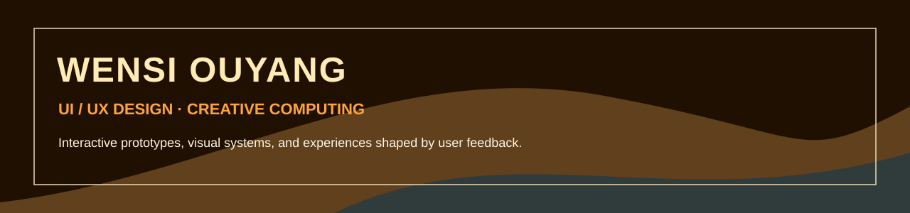

# Wensi Ouyang

**UI/UX designer in Hong Kong, building interactive experiences with code and AI-assisted development tools.**

I work across interface design, data visualisation and physical interaction. I use **Claude Code and Codex** to turn design ideas into functional web applications and prototypes, then refine the experience through visual review, testing and user feedback.

I am currently studying **MSc Innovative Multimedia Entertainment at The Hong Kong Polytechnic University** (2026–2027), following a degree in Media Arts and Design. At **Xterio**, I work as a UI Design Intern in Product Marketing, contributing to Alphawalk’s interface, report visualisation and product communication.

[Design portfolio](portfolio/README.md) · [Download portfolio PDF](portfolio/Wensi_Ouyang_Portfolio.pdf) · [Email](mailto:wensiouyang15@gmail.com)

## Selected coding projects

### Task Monster

A functional web application that turns a large task into a playable quest. Completing a small step changes the monster’s health, expression and rewards; finished quests become collection cards.

**Python · Streamlit · CSS · JavaScript · Codex-assisted development**

<table><tr>
<td align="center"></td>
<td align="center"></td>
<td align="center"></td>
</tr></table>

The project documents two classmate trials and the changes that followed, including optional deadlines and more expressive character feedback. It runs locally and does not require an AI API key.

[Source and running instructions](https://github.com/Whitter-oy/Task-monster-A3) · [Design process and AI use](https://github.com/Whitter-oy/Task-monster-A3/blob/main/PROCESS.md)

### Hong Kong Rainfall Monitor

An interactive exploration of daily rainfall in 2025, with date selection, charts, geographic context and data-driven rain animation. The interface uses Hong Kong Observatory station data; the district map provides context rather than district-level measurements.

**Python · Matplotlib · HTML / CSS / JavaScript · GitHub Pages**

[Open live demo](https://whitter-oy.github.io/HK-rainfall-2025/) · [Source and process](https://github.com/Whitter-oy/HK-rainfall-2025)

### Schotter

A Python interpretation of Georg Nees’ generative artwork, exploring seeded randomness and the transition from an ordered grid to visual disorder. The output is an editable SVG.

**Python · Generative art · SVG**

[View artwork and code](https://github.com/Whitter-oy/schotter)

## Selected design work

| Project | Focus | Evidence |
| --- | --- | --- |
| [Woof Mate](portfolio/woof-mate.md) | Physical interaction, pet companionship and an owner-facing interface | Arduino, Teachable Machine and p5.js prototype, model making and user feedback |
| [MEMOJI](portfolio/memoji.md) | AI-supported emotional expression for older adults | User research, interaction flows and an interface prototype |
| [Green Combo](portfolio/green-combo.md) | Sustainability education through a culturally familiar board game | Research, card and rule design, playtests and iteration |
| [Petified Market](portfolio/petified-market.md) | A critical installation about emotional consumption | Service blueprint, material experiments and an exhibition prototype |
| [Life Mancer](portfolio/life-mancer.md) | Speculative wearable design and technology ethics | Research, model making and scenario storytelling |

[Browse the visual case studies](portfolio/README.md) · [Download the complete 29-page portfolio](portfolio/Wensi_Ouyang_Portfolio.pdf)

## Professional experience

**Xterio · UI Design Intern, Product Marketing · Hong Kong · Aug 2026–present**

- Design the UI and promotional landing page for Alphawalk, a financial AI agent product.
- Use Claude Code to implement the homepage UI and data visualisations for agent-generated reports.
- Conduct internal usability tests with employees and record user behaviour.
- Collaborate with developers on UI fixes and interaction refinements; support product testing, market research and promotional video production.

[More about my Alphawalk contribution](portfolio/alphawalk.md)

## Tools and approach

- **Design:** Figma, Illustrator and Photoshop. UI design, interaction flows and information hierarchy.
- **Development and prototyping:** Claude Code, Codex, Python, Streamlit, HTML, CSS and JavaScript, demonstrated in the linked projects.
- **Physical interaction:** Arduino, p5.js and Teachable Machine, documented in Woof Mate.
- **Research and iteration:** field observation, usability testing, behaviour records and qualitative feedback.
- **Media and 3D:** Premiere Pro, After Effects, Maya and KeyShot.

I am interested in Generative AI, Human–Computer Interaction, and how interactive systems can support creative and cultural experiences.

**Contact:** [wensiouyang15@gmail.com](mailto:wensiouyang15@gmail.com) · Hong Kong

A reflection on my approach to AI-assisted programming: [Why Are We Here?](https://github.com/Whitter-oy/why-are-we-here)
