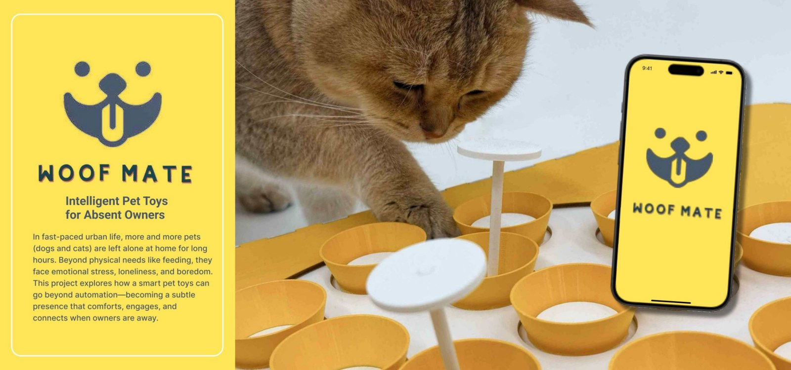
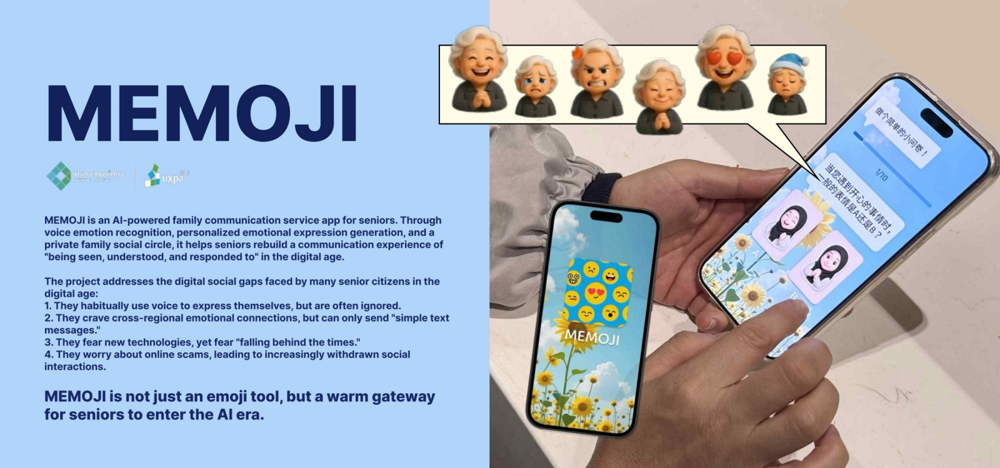
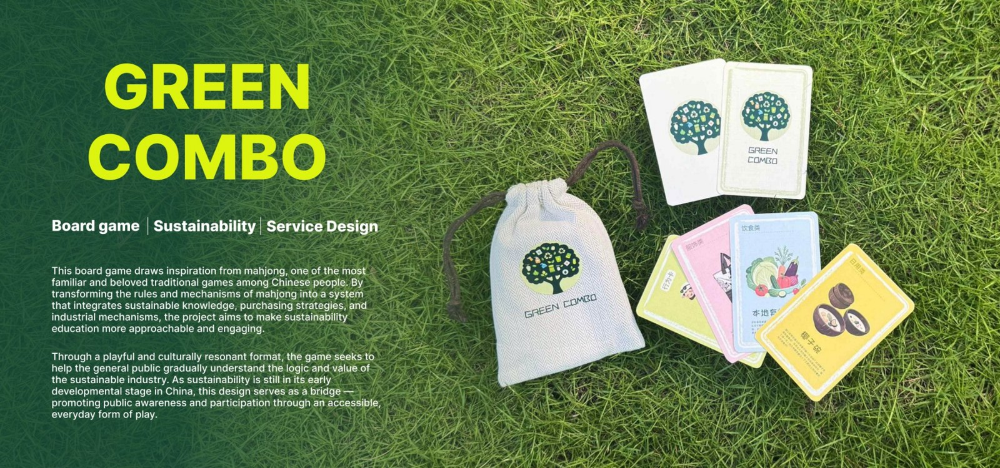
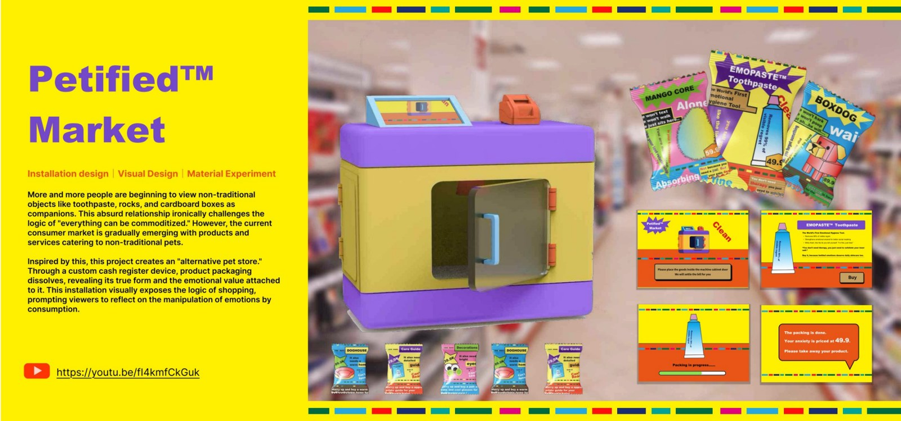
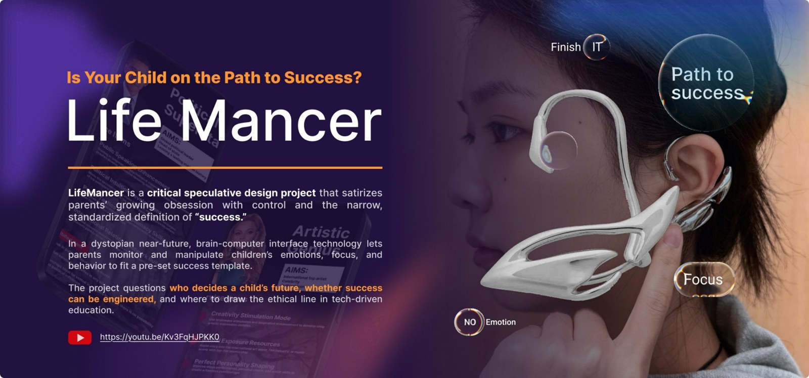

# Design Portfolio

A selection of work across interaction design, physical computing, inclusive communication, service design and speculative art.

[Download the complete portfolio PDF](Wensi_Ouyang_Portfolio.pdf) · [Back to the portfolio overview](../README.md)

## Woof Mate

An interactive pet-toy prototype exploring playful companionship when an owner is away. **Physical computing, gesture recognition, product and interface design.**

[Read case study](woof-mate.md) · Portfolio pages 2–7

## MEMOJI

A design concept for helping older adults communicate emotion through personalised avatars and voice-led interaction. **Inclusive design, AI interaction and user research.**

[Read case study](memoji.md) · Portfolio pages 14–18

## Green Combo

A mahjong-inspired board game that makes sustainable living more approachable through play. **Service design, cultural context and playtesting.**

[Read case study](green-combo.md) · Portfolio pages 8–13

## Petified Market

A fictional pet store that uses dissolving packaging and a checkout installation to question emotional consumption. **Installation design, material exploration and critical design.**

[Read case study](petified-market.md) · Portfolio pages 19–24

## Life Mancer

A speculative wearable and fictional company questioning parental control, educational pressure and standardised definitions of success. **Speculative design, model making and narrative.**

[Read case study](life-mancer.md) · Portfolio pages 25–29

## Alphawalk at Xterio

[Read about my UI design, AI-assisted implementation and internal usability testing](alphawalk.md).

For runnable code, see [Task Monster](https://github.com/Whitter-oy/Task-monster-A3), [Hong Kong Rainfall Monitor](https://github.com/Whitter-oy/HK-rainfall-2025), and [Schotter](https://github.com/Whitter-oy/schotter).
