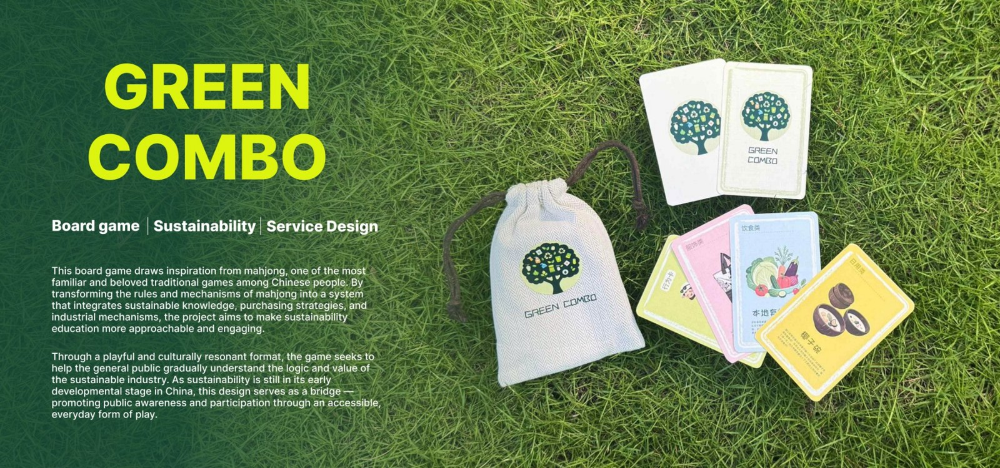

# Green Combo

**Service design · Sustainability · Board game design**

## The question

How can people learn about sustainable living through an approachable activity rather than abstract information alone?

## Design direction

Green Combo uses the familiarity of mahjong to structure a sustainability-themed card game. Players form combinations from everyday activities and products, connecting environmental ideas to choices that can be discussed during play.

## Research and iteration

The portfolio shows stakeholder mapping, a user journey, interviews, rule design, card prototypes and playtests. Feedback led to clearer product descriptions, changes to card distribution, more distinct categories and adjustments to action cards.

The project also considers how the game could circulate through local communities and sustainable retail settings, linking the play experience to a wider service model.

## What this demonstrates

- Using cultural familiarity to lower the barrier to participation.
- Translating a research topic into rules and tangible interactions.
- Iterating on instructions, game balance and visual communication through playtests.

## Scope

This is a physical game and service-design case study. This repository documents the project and does not contain a digital game implementation or an independently measured educational-effectiveness study.

## Visual documentation

See pages **8–13** of the [complete portfolio](Wensi_Ouyang_Portfolio.pdf).

[Back to design portfolio](README.md) · [Portfolio overview](../README.md)
