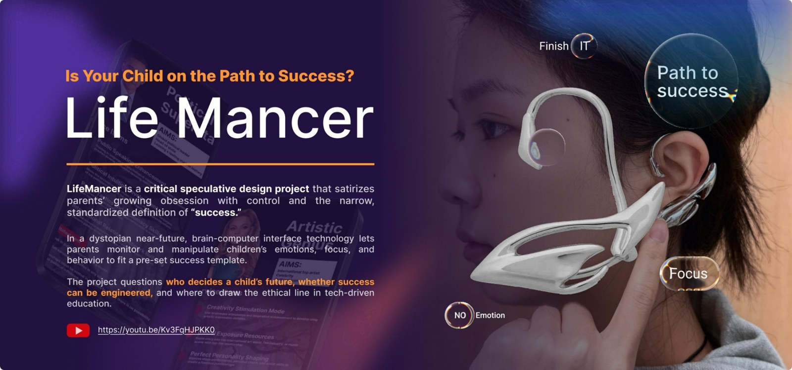

# Life Mancer

**Speculative design · Wearable prototype · Technology ethics**

## The question

Who defines a child’s success, and what happens when a technology promises to optimise behaviour around that definition?

## Design direction

Life Mancer imagines a fictional company and wearable that offers parents control over a child’s focus and behaviour. The deliberately unsettling proposition critiques educational pressure and the idea that success can be reduced to a preset template.

## Making and presentation

The portfolio includes contextual research, a fictional brand, interface and advertising concepts, wearable sketches, physical model making, fit adjustments and scenario photography.

## What this demonstrates

- Exploring ethical questions through a concrete designed scenario.
- Connecting a speculative product to brand language and a wider social narrative.
- Using a physical model and staged scenes to communicate an argument.

## Scope

This is a **speculative artwork and physical appearance model**. The depicted neural control, emotional regulation and hormone-release behaviours are fictional narrative devices, not functioning medical or brain-interface technology.

## Visual documentation

See pages **25–29** of the [complete portfolio](Wensi_Ouyang_Portfolio.pdf).

[Back to design portfolio](README.md) · [Portfolio overview](../README.md)
