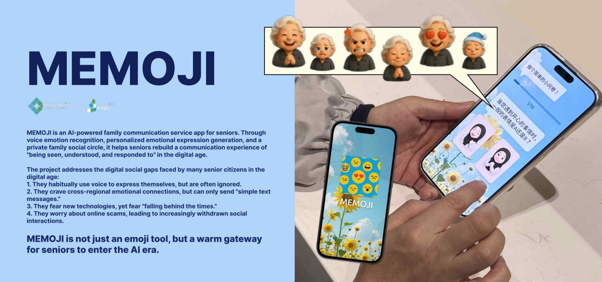

# MEMOJI

**Inclusive design · AI interaction concept · User research**

## The question

How might older adults communicate the emotional tone of a message without relying on unfamiliar emoji conventions or long typed text?

## Design direction

MEMOJI proposes a family communication experience combining voice messages, personalised avatars and expressive emoji suggestions. The flow includes character creation, a personal emoji library, family connections and a voice-led chat interface.

## Research and prototype evidence

The portfolio reports interviews with **10 older adults aged 60–75**, synthesised into three personas. It includes user journeys, screen flows, interface prototypes, a proposed generation pipeline and feedback from older and younger users.

The research centres on a distinction between being able to send a message and feeling that a family member understands its emotional meaning. This informs the focus on familiar voice interaction and personally recognisable expressions.

## What this demonstrates

- Turning qualitative research into interaction requirements.
- Designing for users with different digital habits and levels of familiarity with emoji.
- Exploring how AI-generated expression could fit into a broader communication experience.

## Implementation status

This is an **AI interaction design concept and interface prototype**, rather than a public AI application. This repository does not provide an LLM API integration or a validated emotion-recognition model. Numerical claims shown inside the original concept boards are not presented here as independently verified model-performance results.

## Visual documentation

See pages **14–18** of the [complete portfolio](Wensi_Ouyang_Portfolio.pdf).

[Back to design portfolio](README.md) · [Portfolio overview](../README.md)
