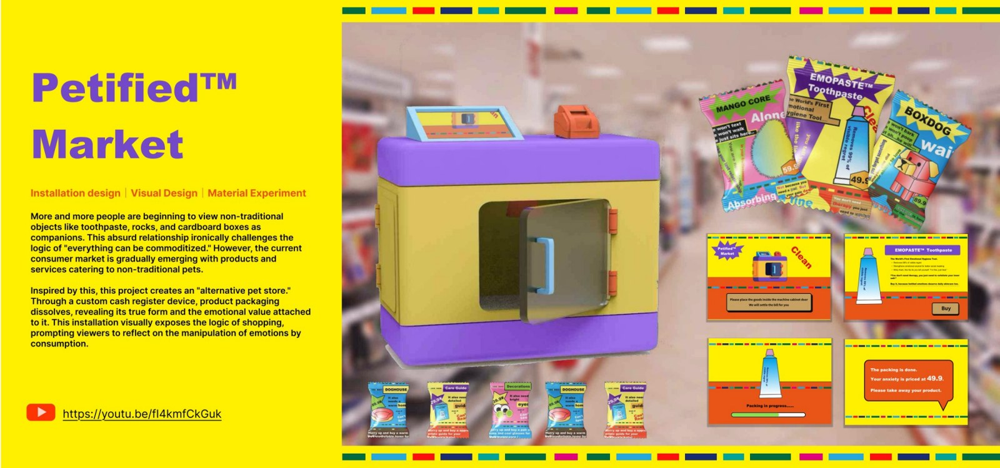

# Petified Market

**Critical design · Interactive installation · Material experiments**

## The question

What are people buying when ordinary objects are packaged as companions: the object itself, or the emotional story around it?

## Design direction

The project takes the form of an alternative pet store. Fictional products, branding and packaging invite visitors to take part in a familiar shopping ritual. At checkout, water dissolves the packaging and reveals the ordinary object inside.

## Making and interaction

The portfolio documents interviews and market observations, a service blueprint, installation sketches, a physical checkout prototype and experiments with dissolving packaging materials. An exhibition sequence records how visitors encounter the store, choose an item and discover the reveal.

## What this demonstrates

- Using a staged interaction to make an argument through experience.
- Coordinating brand, service sequence, physical mechanism and material behaviour.
- Designing an installation that can prompt reflection rather than only communicate information.

## Scope

The store and products form a critical installation and exhibition prototype. They are not presented as a commercial retail service.

## Visual documentation

See pages **19–24** of the [complete portfolio](Wensi_Ouyang_Portfolio.pdf).

[Back to design portfolio](README.md) · [Portfolio overview](../README.md)
