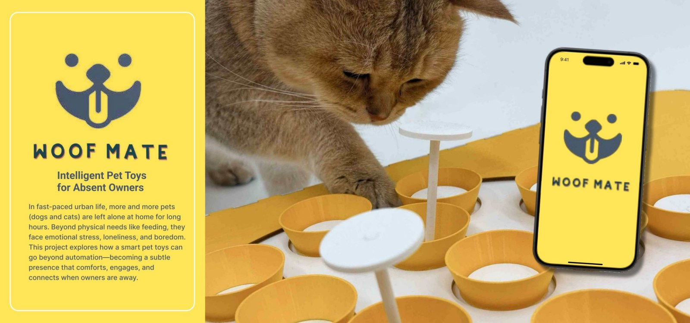

# Woof Mate

**Physical computing · Product design · Interaction design**

## The question

How can a smart pet toy offer more than scheduled feeding and help an absent owner participate in a pet’s play?

## Design and prototype

The project combines a rotating treat-container toy with an owner-facing interface. It explores speed and direction controls, pet activity viewing and playful interaction across physical and digital touchpoints.

The documented working prototype uses an **Arduino**, an **L298N motor driver**, **Teachable Machine** for basic gesture recognition, and **p5.js** to turn recognised gestures into signals for the Arduino. The portfolio also shows physical assembly, 3D-printed parts and model refinement.

## Research and feedback

The portfolio documents an interview, observations of existing pet products and feedback from people trying the concept. Those materials connect the interaction design to concerns about boredom, companionship and a pet’s agency.

## What this demonstrates

- Connecting an input, recognition output and physical response in an interactive prototype.
- Designing both a tangible product and its supporting screen-based experience.
- Using feedback and model making to refine how an interaction works.

## Scope

This is a physical interaction prototype and design case study. The portfolio’s proposed activity reports and companion-app services should be read as design features, rather than a publicly deployed software service. Source code for the hardware prototype is not included in this repository.

## Visual documentation

See pages **2–7** of the [complete portfolio](Wensi_Ouyang_Portfolio.pdf).

[Back to design portfolio](README.md) · [Portfolio overview](../README.md)
